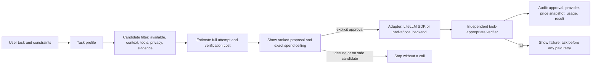

# Cheapest capable route: research, architecture, and prototype

**Date:** 2026-10-17
**Prepared by:** Router-17
**Spend:** $0. No provider APIs, model subscriptions, or external benchmark services were used.

## The question

Can Mega Zword choose the cheapest resource that is sufficiently capable for a particular task, execute it, check the result, and keep the user in control?

**Answer:** yes, as a bounded workflow with measured task-specific evidence and a hard approval/spend gate. It is not something a price table or a model router can establish by itself. LiteLLM can remove much of the provider-call and pricing plumbing; Mega Zword must own the quality threshold, policy, approval, and independent verification.

## What LiteLLM already provides

The official [Router documentation](https://docs.litellm.ai/docs/routing) describes cost-based routing across configured deployments and allows custom input/output prices. It also documents pre-call context-window checks, load/health strategies, and fallback handling. This is useful execution and deployment plumbing. Its cost strategy answers “which configured deployment has the lower configured price?” It does not establish that the least expensive model will meet *this task's* quality floor.

LiteLLM's [model metadata schema](https://github.com/BerriAI/litellm/blob/main/model_prices_and_context_window.schema.json) includes per-model cost, limits, and optional capability flags. Those flags can be absent, and the schema says new optional fields are added over time. Treat missing capability or price as unknown, never as support or free. The public catalog is a maintained input, not a bill or an independent quality test.

The [license](https://github.com/BerriAI/litellm/blob/main/LICENSE) puts repository content outside `enterprise/` under MIT; enterprise content has a separate license. Keep any integration to the MIT-licensed package/surface and re-check the exact files/features before shipping.

One important safety trap: the official [budget documentation](https://docs.litellm.ai/docs/proxy/users) says proxy spend budgets require a database and fail open in a DB-less deployment. LiteLLM can help meter spend, but it must not be Mega Zword's only hard limit. Its proxy also adds an always-on service/database operating surface. For this desktop tool, start with the LiteLLM SDK behind an adapter; consider a proxy only if shared keys, central spend reporting, or multiple clients justify the service.

The existing Mega Zword code already has a provider abstraction, a free/paid budget guard, run logging, source discovery, and fair-share routing. The missing part is a task-specific policy loop and transparent proposal/approval/verification record. Replacing all of that with a generic proxy would discard useful controls.

## Recommendation

Keep Mega Zword as the policy owner. Use LiteLLM as an optional, replaceable execution adapter and metadata importer, not as an autonomous chooser. Continue using the existing native CLI backends where their subscription semantics or tool access are a better fit.



Candidate eligibility should be conjunctive: available now; known billability; context fits; required tool/modality and privacy constraints are met; an adequately sampled, task-family success estimate clears the user's minimum reliability floor; and the estimated request plus any verifier cost fits the user's explicit ceiling. Then rank eligible candidates by expected *total* cost (including retries and verification), with reliability as a tie-breaker. Unknown price/billability, stale health, or inadequate evidence means “not eligible yet.”

The confidence floor is a policy choice, not a fact about an LLM. The prototype uses a 95% Wilson lower confidence bound on task-family fixture observations. A production version should calibrate this against held-out tasks, record model/version/provider/benchmark provenance, impose a minimum sample count, and invalidate evidence when any of those change. Avoid claiming objective certainty for subjective writing tasks; there the user should choose the trade-off or review the result.

Control requirements: default to preview; require approval for each external execution; show provider/model, data destination, estimated cost, and maximum cost before approval; never silently fall back to a billable route; let the user cap/stop/retry; require fresh approval if a retry raises the cap; keep a local append-only audit without prompt content by default. Verification is separate from generation: run tests/schema checks where possible, use a second source or human review where not, and report “unverified” rather than equating a fluent answer with a correct answer.

## Prototype and benchmark

`megazword route-lab` is an offline demonstration. It has no provider SDK, key lookup, network code, or live execution path. Its four candidates, prices, task-family outcomes, and outputs are fabricated fixtures. `preview` proposes a route; only the explicit `--approve` flag runs the local fixture and deterministic verifier. The default simulated budget is $0. `benchmark` compares:

- **cheapest-only:** always take the cheapest candidate, without a capability/reliability gate;
- **LiteLLM cost-based:** same price-only choice, representing cost-based routing over the same synthetic deployments (not a claim that LiteLLM itself made this benchmark call);
- **qualified-cheapest:** exclude candidates that miss required capabilities, the 95% lower-bound quality floor, or user ceiling, then choose the cheapest remaining;
- **strongest:** choose the candidate with the highest synthetic task-family success rate.

The deterministic benchmark uses three task profiles and 100 expected requests per profile (300 simulated requests total). Its “pass rate” is calculated from made-up 100-observation counts; estimated spend uses made-up token prices. These results demonstrate policy behavior only. They are **not** measured LLM performance, provider pricing, or a prediction of savings in real use.

### Observed prototype output

| Policy | Expected pass rate | Profiles clearing their confidence floor | Synthetic spend for 300 requests |
|---|---:|---:|---:|
| Cheapest-only | 77.3% | 1/3 | $0.00 |
| LiteLLM cost-based (price only) | 77.3% | 1/3 | $0.00 |
| Qualified-cheapest | 94.0% | 3/3 | $0.67 |
| Strongest candidate | 97.0% | 3/3 | $0.87 |

In this fixture, qualified-cheapest spends 23.0% less than strongest while clearing all three floors. Its selected routes are: free-hosted for summary; strong-api for extraction and code. That is exactly the trade-off the experiment was designed to expose: lowest price alone is not the objective; minimize cost *after* the reliability constraint. The zero-price remote fixture still consumes a fictional free quota and requires `--approve`; the prototype does not claim quota is valueless.

Run locally from a checkout with `src` on `PYTHONPATH`:

```powershell
$env:PYTHONPATH = (Join-Path (Get-Location) 'src')
python -m megazword.cli route-lab benchmark
python -m megazword.cli route-lab preview --task code --budget-usd 0.01
python -m megazword.cli route-lab preview --task code --budget-usd 0.01 --approve
python -m megazword.cli route-lab preview --task summary --no-remote
```

Use `--reliability-floor 0.9` to override the task's illustrative threshold. `--no-remote` excludes hosted endpoints even when their listed monetary price is zero. The third command executes only the hard-coded local fixture. It cannot spend the specified amount or call any provider.

## Limits and next proof needed

This prototype proves the deterministic control flow and local verifiers, not that the lowest qualifying live model is reliable. Before enabling real automatic routing, build a small, versioned evaluation set per task family; benchmark only providers already available on a no-cost basis or explicitly approved; measure actual task pass rates, latency, failures, and billed totals; verify bills against provider usage records; and test that a decline, stop, exhausted cap, unknown price, and retry all prevent a call. A free-tier call can still consume a user's quota, so “$0” does not mean “no resource cost.”

Do not install LiteLLM in the app dependency set until the adapter's footprint, Windows packaging, supported-provider coverage, and dependency/licensing audit are measured. The next low-risk step is an optional adapter spike in a separate branch, using a fake transport in tests; live calls remain opt-in and outside this PR.
